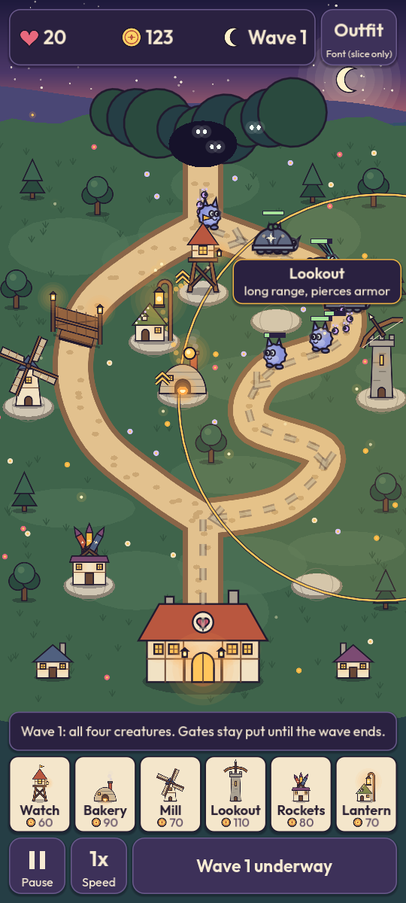
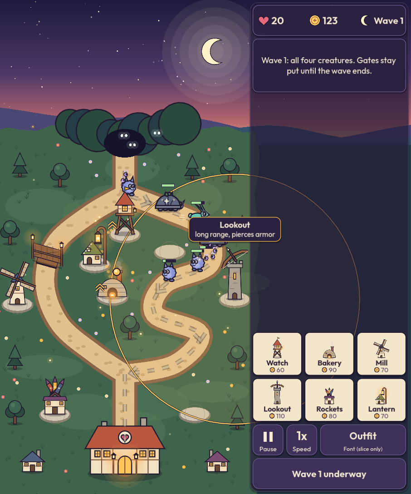
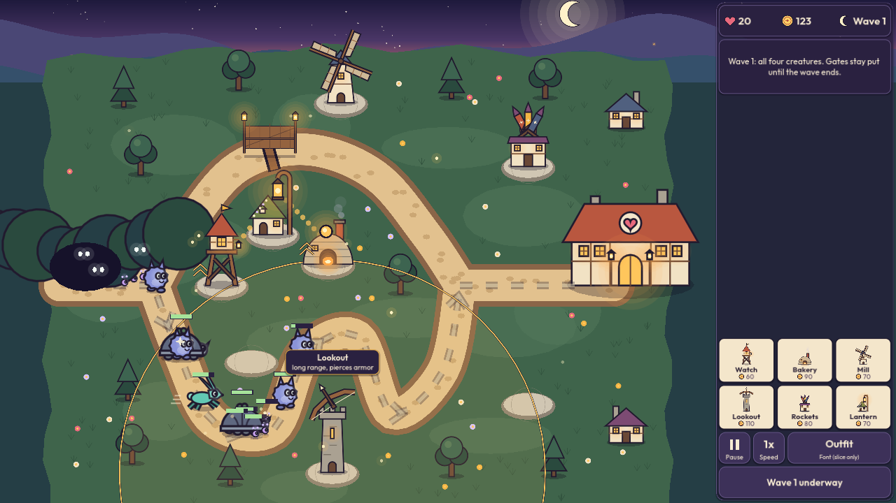
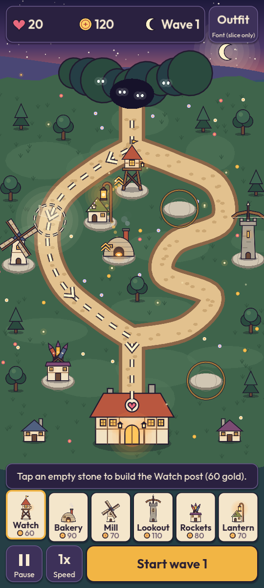
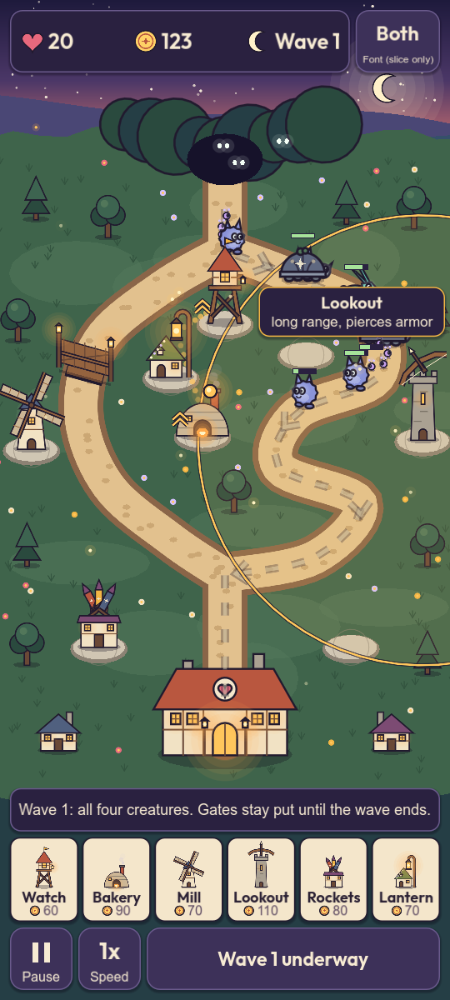
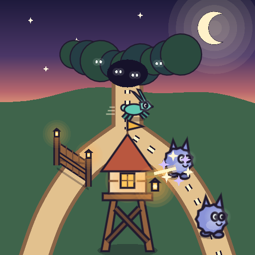
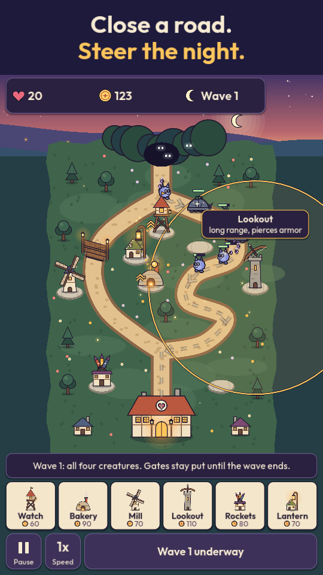

# Forkline theme: the dusk storybook

Art director, 2026-10-23. Phase 3, for hard stop A. The slice code in `prototypes/theme/` is thrown away after hard stop A. The look, the tokens and the lessons on this page carry forward into `src/theme/` in phase 4.

## The idea

A hillside village at dusk, drawn like a picture book: flat shapes, soft dusk colors, and one dark ink outline around everything. The sky fades from deep indigo to apricot. Lanterns are the warm points of light. The night creatures come out of a dark thicket at the top of the hill, cool colored with glowing eyes, and walk the sandy road down to the hearth hall at the bottom. When one is beaten it puffs into a little cloud and sparkles. Nothing bleeds and nothing dies on screen.

The road forks below the thicket and joins again above the village. That fork is the game, so the map shows it plainly: two sandy roads on dark grass, a moonlit dashed route line with arrows on the road the creatures will take, and a glowing ring where the gate can go. When the gate closes, the route line flashes and redraws down the other road.

Three rules hold the look together:

1. **Warm is ours, cool is theirs.** Towers, lanterns, the village and the HUD's gold and honey accents are warm. Creatures are periwinkle, mint, slate and lilac. A player can tell sides apart at a glance, and the shape tells the rest.
2. **Ink outlines on everything that matters.** Towers, creatures and the gate all have a dark ink line (`INK_LINE`). That outline is what keeps a periwinkle creature readable on a sandy road (9.79:1), so contrast never depends on the fill color.
3. **Shape before color.** Every tower and creature has one signature shape that survives being filled with a single flat color (see the silhouette sheet).

## Run the slice

- Phone build: the DM sets `run/main_scene="res://prototypes/theme/slice.tscn"` (see the report for the export filter change it also needs).
- Windows: `godot --path . res://prototypes/theme/slice.tscn`. Resize the window to see the layout switch.
- Screenshots: `bash prototypes/theme/screenshots.sh` writes every image on this page.
- Contrast check: `godot --headless --path . --script res://prototypes/theme/contrast.gd` (exit 0 means every pair passes).

What you can do in the slice: tap the glowing ring on the short road to drop the gate (and tap again to lift it), pick a tower card and tap an empty stone to build, tap a tower to see its range and job, start waves, pause, change speed, and cycle the font button. Gates lock while a wave runs. The four waves loop with tougher creatures.

## Layout: portrait and landscape by window shape

| Portrait (phones, Fold5 cover screen) | Fold5 inner screen shape | Wide window |
|---|---|---|
|  |  |  |
| 540 x 1200 window | 906 x 1088 window | 1280 x 720 window |

- The slice reads only the window size. Width divided by height of 0.8 or more uses the landscape layout. The Fold5 inner screen held upright is about 0.83, so it gets landscape on its own, with no setting. Normal phones are about 0.45.
- Portrait: the read-only numbers (lives, gold, wave) sit at the top. Everything the thumb presses sits at the bottom: the hint line, six tower cards, then Pause, Speed and Start wave.
- Landscape: one column on the right holds the same parts, with Start wave at the bottom right under the thumb.
- The map is defined once in map units. Portrait always flows down. Landscape flows down or across, whichever draws the map bigger (across on a 16:9 window). Buildings always stand upright, so only positions move. Because the game state is in map units, a layout change mid-wave loses nothing.
- Touch targets: 150 viewport units, and never less than 50 dp (the slice measures dp from the screen's dpi and prints it). On the Fold5 cover screen 150 units is about 50 dp; on the inner screen about 58 dp.

The build phase, with the Watch post card picked (pads glow honey) and the gate ring glowing on the short road:



## Palette tokens

All colors live in `prototypes/theme/palette.gd`. Values are original, picked for this page.

| Token | Hex | Use |
|---|---|---|
| SKY_TOP | `#1e1a3c` | night sky, caption band |
| SKY_MID | `#4b3767` | dusk plum |
| SKY_LOW | `#b8676d` | rose near the hills |
| SKY_GLOW | `#f0ad7c` | apricot horizon |
| MOON / STAR | `#fff1c9` / `#fff6e0` | moon, stars, wave icon |
| HILL_FAR / HILL_MID / HILL_NEAR | `#4a4775` / `#35506b` / `#253e45` | far hills and the ground off the map |
| MEADOW / MEADOW_LIGHT / MEADOW_DARK | `#3f644b` / `#52775a` / `#33543f` | map grass, patches, tufts |
| ROAD / ROAD_EDGE / ROAD_DOT | `#e2c18e` / `#8a6548` / `#cba774` | sandy road, its border, cobbles |
| ROUTE | `#fff4cc` | route line core (inside an ink casing) |
| PAD / PAD_EDGE | `#d0c6b3` / `#8c8274` | stone build pads |
| LANTERN / LANTERN_CORE / GLOW | `#ffc65c` / `#fff3c2` / `#ffa94a` | lantern light, windows, glows |
| PLASTER / PLASTER_SHADE / TIMBER / WOOD | `#f1e2c4` / `#cdb796` / `#6a4836` / `#94633f` | cottage walls and beams |
| ROOF_CLAY / ROOF_SLATE / ROOF_MOSS / ROOF_PLUM | `#b9573f` / `#50607f` / `#71844a` / `#7c4b73` | roofs |
| STONE / STONE_DARK | `#aaa192` / `#7a7266` | Lookout, chimneys |
| TREE / TREE_DARK | `#3d6450` / `#2a4a3e` | trees, thicket |
| INK_LINE | `#211a2e` | every outline, text outlines |
| CREATURE_BASIC / FAST / ARMOR / ARMOR_SHELL / SWARM | `#8a93d8` / `#62c8b3` / `#8d97a8` / `#5f6880` / `#bf96e8` | night creatures |
| EYE / SPARKLE / SPARKLE_LILAC / FLOUR / SMOKE | `#f4fff6` / `#fff6d6` / `#d5c2ff` / `#e8f0ff` / `#c9c0dc` | eyes, puffs, slow effect |
| PANEL / PANEL_RAISED / PANEL_EDGE | `#2a2140` / `#3d3159` / `#6a5a8c` | HUD panels and buttons |
| CARD / CARD_DIM | `#f4e6cb` / `#cfc3ad` | tower cards (dim when gold is short) |
| TEXT_LIGHT / TEXT_DARK / TEXT_MUTED | `#f7ebd3` / `#2a2033` / `#5a4760` | text |
| HONEY / HEART / COIN | `#f2b544` / `#e8697d` / `#ffd166` | primary button, lives, gold |
| HP_BACK / HP_FILL | `#2a2140` / `#a6e39a` | creature health bar |

### Contrast, checked by script

`prototypes/theme/contrast.gd` uses the WCAG 2 formula. Text pairs need 4.5:1. Graphic pairs (icons, outlines, the route line, pads) need 3:1. Output on 2026-10-23:

```
Text pairs (need 4.5:1)
  ok    12.79:1  TEXT_LIGHT on PANEL          #f7ebd3 on #2a2140  (HUD numbers, hint line, toasts)
  ok     9.98:1  TEXT_LIGHT on PANEL_RAISED   #f7ebd3 on #3d3159  (pause, speed and font buttons)
  ok     8.48:1  TEXT_DARK on HONEY           #2a2033 on #f2b544  (Start wave button)
  ok    12.59:1  TEXT_DARK on CARD            #2a2033 on #f4e6cb  (tower card names)
  ok     6.80:1  TEXT_MUTED on CARD           #5a4760 on #f4e6cb  (tower card costs)
  ok     8.92:1  TEXT_DARK on CARD_DIM        #2a2033 on #cfc3ad  (card name when gold is short)
  ok     4.82:1  TEXT_MUTED on CARD_DIM       #5a4760 on #cfc3ad  (card cost when gold is short)
  ok    14.02:1  TEXT_LIGHT on SKY_TOP        #f7ebd3 on #1e1a3c  (titles on the night sky)
  ok    11.63:1  COIN on INK_LINE             #ffd166 on #211a2e  (floating +gold, drawn with an ink outline)
  ok    14.20:1  TEXT_LIGHT on INK_LINE       #f7ebd3 on #211a2e  (map labels with an ink outline)
Graphic pairs (need 3.0:1)
  ok     3.91:1  ROAD on MEADOW               #e2c18e on #3f644b  (road against grass)
  ok     9.79:1  INK_LINE on ROAD             #211a2e on #e2c18e  (creature and gate outlines on the road)
  ok     9.91:1  INK_LINE on PAD              #211a2e on #d0c6b3  (tower outlines on their build pad)
  ok     5.23:1  PLASTER on MEADOW            #f1e2c4 on #3f644b  (cottage walls against grass)
  ok     3.31:1  INK_LINE on MEADOW_LIGHT     #211a2e on #52775a  (outlines on the lightest grass)
  ok    15.23:1  ROUTE on INK_LINE            #fff4cc on #211a2e  (route dash core inside its ink casing)
  ok     3.96:1  PAD on MEADOW                #d0c6b3 on #3f644b  (empty build pad on grass)
  ok     4.85:1  HEART on PANEL               #e8697d on #2a2140  (lives icon)
  ok    10.48:1  COIN on PANEL                #ffd166 on #2a2140  (gold icon)
  ok    13.44:1  MOON on PANEL                #fff1c9 on #2a2140  (wave icon)
  ok     8.25:1  HONEY on PANEL               #f2b544 on #2a2140  (Start wave button edge)
  ok    12.25:1  CARD on PANEL                #f4e6cb on #2a2140  (tower card edge)
  ok    10.77:1  LANTERN on INK_LINE          #ffc65c on #211a2e  (lantern windows in their frames)
  ok    10.13:1  HP_FILL on HP_BACK           #a6e39a on #2a2140  (creature health bar)
0 failing pairs.
```

Text always sits on an opaque panel or has an ink outline, so these pairs are the real ones. Two pairs failed on the first run (road and pads on a lighter meadow); the meadow was darkened and the road and pads lightened until they passed.

## Font: Outfit, System, or Both

The round button at the top right (bottom right in landscape) cycles three modes, so Bart can compare in his hand:

- **Outfit**: Outfit everywhere (numbers and buttons at weight 650, hints at 450).
- **System**: the phone's own sans serif (Roboto on most Android phones) everywhere.
- **Both**: Outfit for numbers, titles and buttons; the system font for hints and small labels.

| Outfit | System | Both |
|---|---|---|
|  |  |  |

Art director's lean: **Outfit**, or Both. Outfit's round, even strokes match the soft storybook shapes and make the numbers friendly; the system font reads a little office-like next to the art. The slice copies `Outfit[wght].ttf` and `OFL.txt` unmodified into `prototypes/theme/fonts/` (MD5 `e31a3aa5fce3366bcadb8e9027f26178` and `fc7bcc2f3d37195db3ea982ccfecd531`, matching the playbook's copies). If Bart picks System, those two files go away with the slice.

## Silhouette sheet


Each tower is a lantern-lit building with one signature shape. The bottom row of each pair is the same drawing in one flat color.

| Tower (tier 1) | Job | Signature shape |
|---|---|---|
| Watch post | rapid single target | small cabin up on splayed stilts with an X brace, steep roof and pennant: a tall "A" |
| Bakehouse | splash | wide low beehive dome with an offset chimney; lobs glowing embers that burst |
| Flour mill | slows | four turning sails: a big "X"; puffs of flour make creatures drowsy |
| Lookout | long range, pierces armor | the tallest: a stone column with a wide bow on top: a "T"; the bow tilts toward its target |
| Firework loft | anti air | low box cottage with a fan of three finned rockets: a spiky crown |
| Lantern cottage | boosts neighbors | low gabled cottage beside a tall crook holding a big lantern: a "?" shape |

| Creature | Kind | Signature shape |
|---|---|---|
| Nightling | basic | round fuzzy ball with two pointed ear tufts and big eyes |
| Dasher | fast | long-eared runner stretched out mid-leap, with speed lines |
| Shellback | armored | wide stone dome shell with a small head peeking out, moss on top |
| Mites | swarm | tiny beads with glowing antennae that always come in clusters |

Signals that never rely on color alone:

- Slowed creatures get two drowsy swirls over their heads.
- Boosted towers get a double up chevron beside them, plus a dotted light trail from the Lantern cottage.
- A closed gate is a wooden gate with two lantern posts plus a plank across the road; an open socket is a dashed glowing ring with a faint ghost gate.
- The route is a dashed line with arrows, not a tint.
- An unaffordable card dims, and its cost stays readable (4.82:1).

## Store icon, 512 x 512

 

The road comes out of the dark thicket (glowing eyes), forks around a big Watch post, and runs down both sides. A wooden gate closes the left branch. Night creatures walk the open right branch, and the tower's lantern shot puffs one into sparkles. Moon and dusk sky at the top. No text.

The stranger test: a tower in the middle, enemies on a road, a shot hitting one. Those three together say "tower defense". The fork and the gate say what is different. At 48 px (right) the tower, the sandy fork and the dusk sky still read; the creatures become small blue shapes. Keep the key content inside the middle 80 percent, since Play rounds the corners.

## First store screenshot



A 9:16 portrait frame (540 x 960 here; the real one would be 1080 x 1920) with a two line caption on the night sky, "Close a road. / Steer the night.", above live play: the gate closed on the short road, creatures on the long road, range ring and the tower cards along the bottom. A stranger sees a map, a road, towers, enemies, health bars and a row of tower cards: tower defense, at a glance.

## Sound

All synthesized in `prototypes/theme/synth.gd` into `AudioStreamWAV` streams, no audio files.

- Music: a 15 second waltz lullaby loop in F major, 96 beats a minute: a music box melody, a soft bass with added harmonics so it carries on a phone speaker, quiet chord plucks, and a gentle echo wrapped around the loop so it never clicks. Built on a worker thread in about 0.6 s on the Windows PC, so play starts at once and music fades in after.
- Effects: tower shot "pip" (pitched down for the Lookout and up for rockets), Bakehouse "thoomp", creature puff (a breath of noise and two rising chimes), gate closed (wooden knock and warm bell), gate lifted (lighter knock, lower bell), build (knock and two rising bells), a creature reaching the village (two falling notes), button tap.

## Risks

1. **Busy map at small sizes.** Flowers, tufts, fireflies and glows add charm but compete with the creatures. Creatures are about 0.06 of the map width; on the cover screen a Nightling is roughly 25 dp tall. Phase 4 should keep the decoration darker and sparser near roads and may need creatures 10 to 20 percent bigger. Bart's hand test decides.
2. **Small text on the cover screen.** Hint and card labels are about 13 dp there. Readable, but at the low end. Keep body text at 40 viewport units or more in the real UI.
3. **Store screenshots can't be 20:9.** Play allows at most 2:1, and the game's own portrait frame is 20:9. Store screenshots must be framed at 9:16 like the one above, with a caption band.
4. **The road and grass are close in brightness for some color blind players.** The road passes at 3.91:1 and has a dark border (`ROAD_EDGE`), but a deuteranope sees sand and green as similar hues. The border and the cobble dots keep the edge visible. Check again with a simulator in phase 4.
5. **Silhouette pairs to watch.** The Bakehouse dome and the Lantern cottage are both low buildings; the chimney and the tall crook carry the difference. The Watch post and the Lookout are both tall; stilts with a peaked roof against a solid column with a bow. Tier 2 and 3 art must keep each signature shape.
6. **Performance.** The world is redrawn every frame with `_draw()` calls (about a thousand canvas commands in a busy wave). Fine on the PC; the Fold5 check is still to do. The real render code should cache the static ground (the slice already redraws it only on resize) and batch glows.
7. **Music build time on the phone.** About 0.6 s on the PC, likely a few seconds on the phone. It runs on a worker thread, so play is not blocked, but the real audio code should build it once and keep it.
8. **Originality.** Every shape here was drawn for Forkline from simple primitives. The look borrows no characters, layouts, palettes or tower designs from any game, and no game is named anywhere. Generic ideas (a windmill, a watch tower, a hare-like runner) are common folk imagery, not any game's designs.

## Lessons that carry forward to phase 4

- Keep the map in map units and convert to the screen at draw time. Orientation and fold changes then cost nothing.
- Decide layout by window aspect (0.8 threshold) and pick the map flow by fit. No orientation setting.
- One ink outline color for all game objects; text always on an opaque panel or with an ink outline.
- Each tower: a lantern somewhere, one signature shape, one material (wood, clay, plaster and sails, stone, plum roof, moss).
- Creatures: cool colors, glowing pale eyes, and a single readable body shape each.
- Contrast is checked by a script against named tokens, not by eye.
