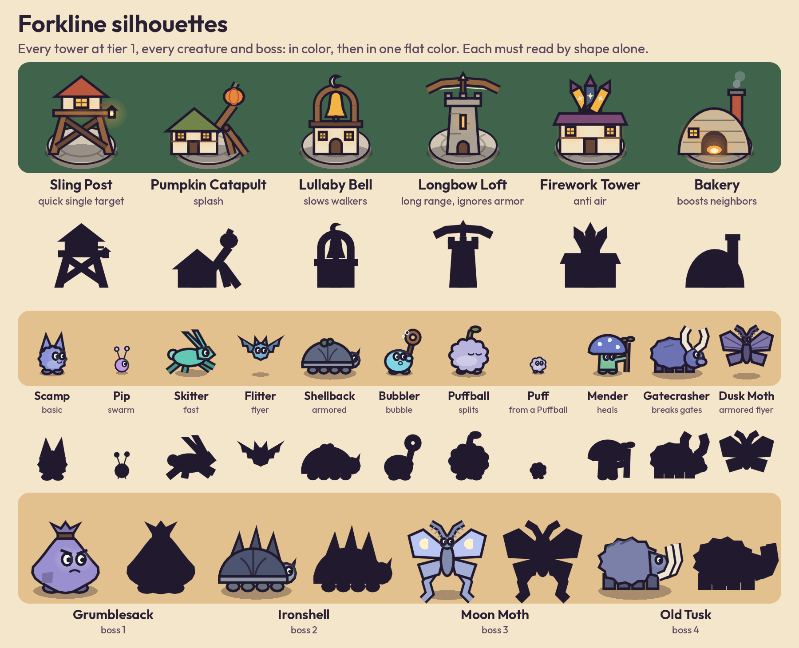
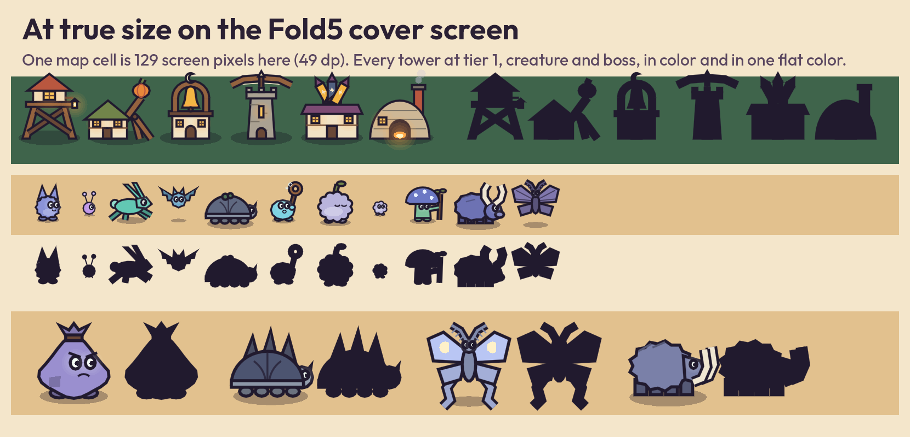
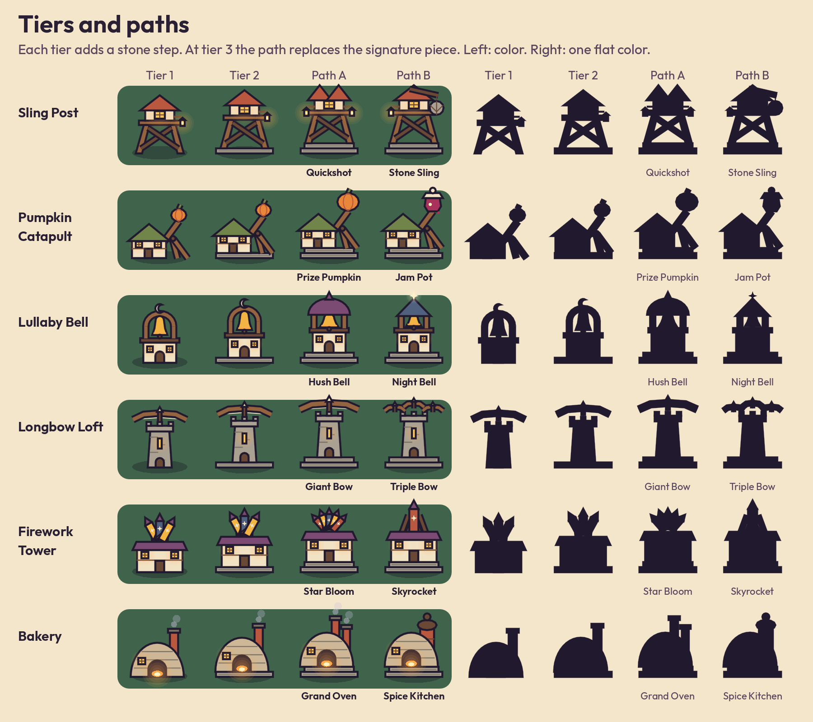
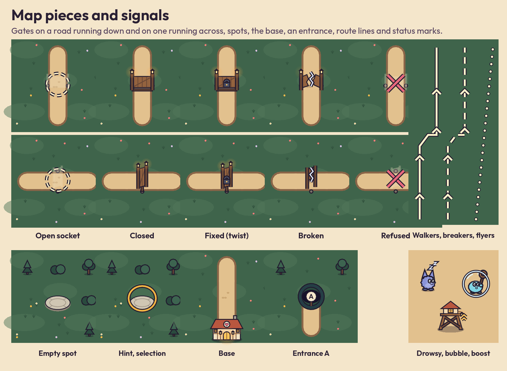
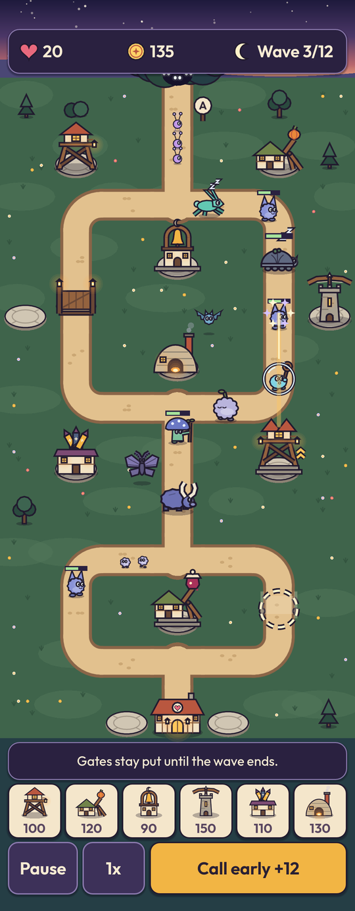
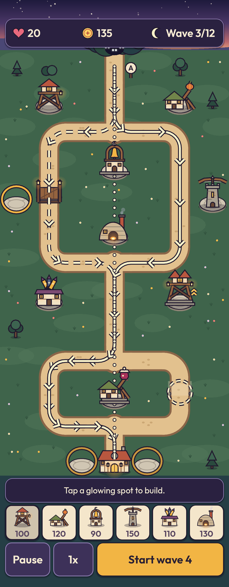
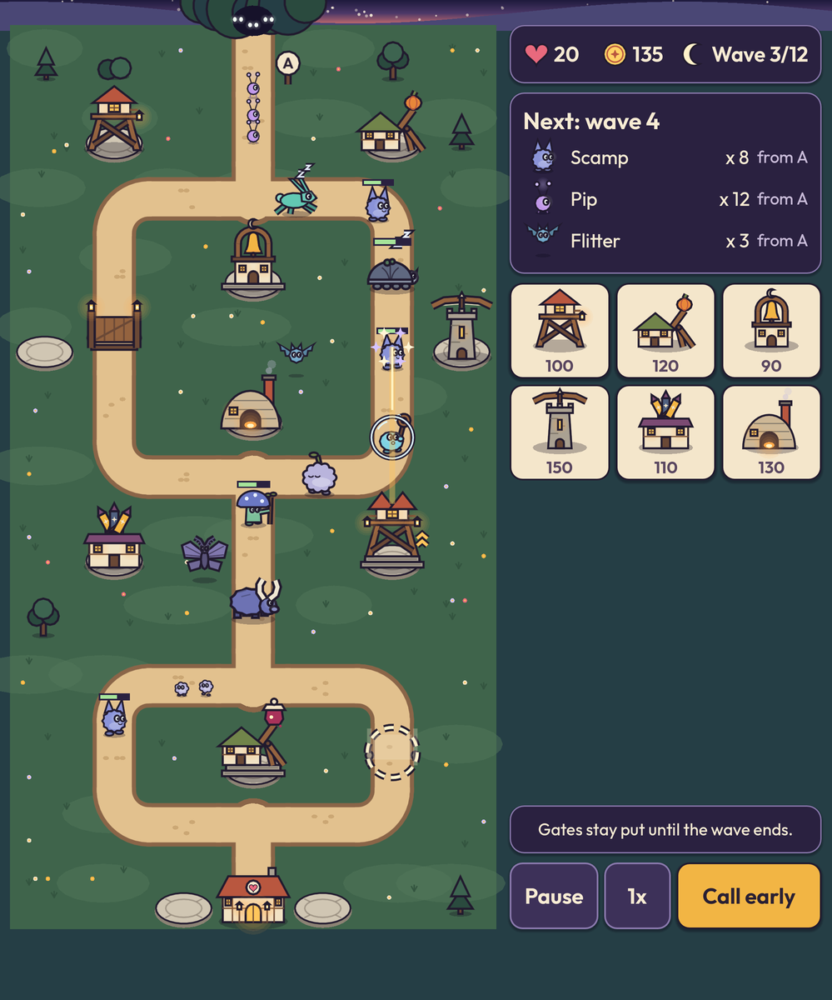
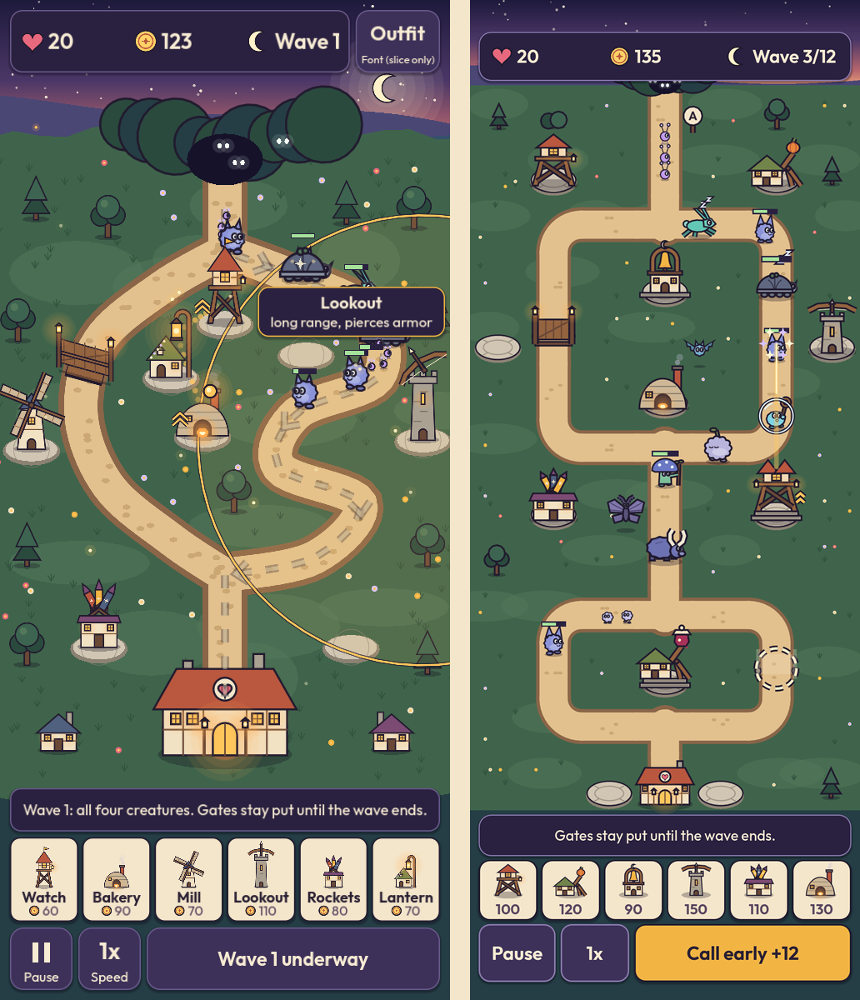
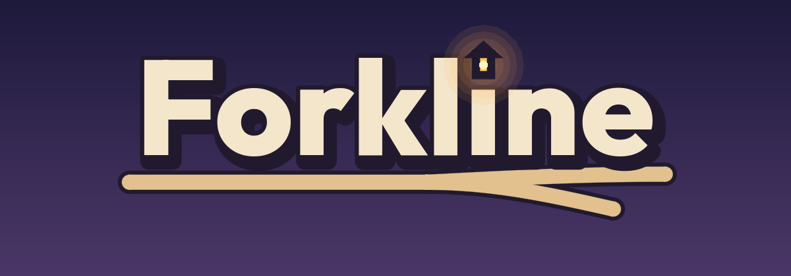
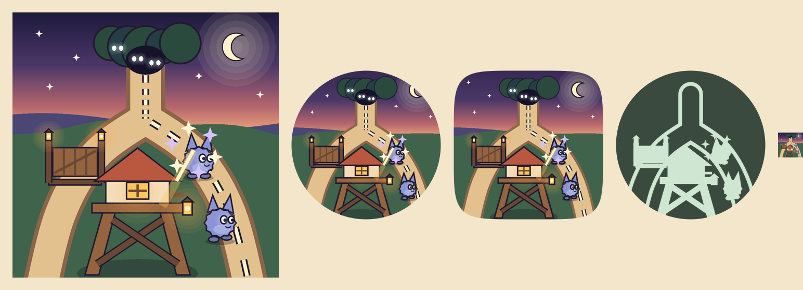

# Forkline theme: the dusk storybook

Art director. Phase 3 slice approved at hard stop A (2026-10-23). This page now describes the design system in `src/theme/`, built in phase 4. Names are in [NAMES.md](NAMES.md); code uses only ids until Bart has seen that list.

## The idea

A hillside village at dusk, drawn like a picture book: flat shapes, soft dusk colors, and one dark ink outline around everything. The sky fades from deep indigo to apricot. Lanterns are the warm points of light. The night creatures come out of a dark thicket at the edge of the map, cool colored with glowing eyes, and walk the sandy road to the hearth hall. When one is beaten it puffs into sparkles. Nothing bleeds and nothing dies on screen.

Three rules hold the look together:

1. **Warm is ours, cool is theirs.** Towers, lanterns, the village and the HUD's honey accents are warm. Creatures are periwinkle, mint, slate, lilac and teal.
2. **Ink outlines on everything that matters.** Towers, creatures and gates have one `INK_LINE` outline, so contrast never depends on a fill color.
3. **Shape before color.** Every tower and creature has one signature shape that survives being filled with one flat color. A test checks it.

## The files

| File | Class | What it gives |
|---|---|---|
| src/theme/palette.gd | `Palette` | Color tokens, the text and graphic pairs, `contrast()` |
| src/theme/ui_theme.gd | `UiTheme` | `build() -> Theme`, `font(weight)`, font sizes |
| src/theme/silhouettes.gd | `Silhouettes` | `draw_tower`, `draw_enemy`, `enemy_size`, status marks, HUD glyphs, the id lists |
| src/theme/map_art.gd | `MapArt` | Meadow, roads, spots, sockets, gates, the base, entrances, route lines, highlights |
| src/theme/wordmark.gd | `Wordmark` | The wordmark as a Control, and `draw_into()` for any canvas |
| src/theme/icon_art.gd | `IconArt` | The launcher and store icon: `paint()`, and `draw()` / `draw_layer()` as Images |
| src/theme/ink_pen.gd | `InkPen` | The drawing helper behind all of the above. Internal to src/theme/ |
| src/theme/fonts/ | | `Outfit[wght].ttf` and `OFL.txt`, unmodified |
| tools/icon/make_icon.gd | | Writes the launcher PNGs into icons/ |
| tools/icon/art_review.gd | | Writes every review image on this page |
| tests/theme/ | | Contrast, silhouettes, map helpers, UI theme and font, launcher icons |

Everything is drawn with Godot's canvas calls. There are no image, texture or shader files. src/theme/ uses nothing outside Godot's core types.

## Palette tokens

All tokens are constants on `Palette`. Values are original, picked for Forkline.

| Group | Tokens |
|---|---|
| Sky | `SKY_TOP #1e1a3c`, `SKY_MID #4b3767`, `SKY_LOW #b8676d`, `SKY_GLOW #f0ad7c`, `MOON #fff1c9`, `STAR #fff6e0`, `HILL_FAR #4a4775`, `HILL_MID #35506b`, `HILL_NEAR #253e45` |
| Map | `MEADOW #3f644b`, `MEADOW_LIGHT #52775a`, `MEADOW_DARK #33543f`, `ROAD #e2c18e`, `ROAD_EDGE #8a6548`, `ROAD_DOT #cba774`, `ROUTE #fff4cc`, `PAD #d0c6b3`, `PAD_EDGE #8c8274`, `THICKET #16122a` |
| Buildings | `LANTERN #ffc65c`, `LANTERN_CORE #fff3c2`, `GLOW #ffa94a`, `PLASTER #f1e2c4`, `PLASTER_SHADE #cdb796`, `TIMBER #6a4836`, `WOOD #94633f`, `ROOF_CLAY #b9573f`, `ROOF_SLATE #50607f`, `ROOF_MOSS #71844a`, `ROOF_PLUM #7c4b73`, `STONE #aaa192`, `STONE_DARK #7a7266`, `IRON #4b4f63`, `PUMPKIN #e8873a`, `JAM #a8325a`, `TREE #3d6450`, `TREE_DARK #2a4a3e`, `INK_LINE #211a2e`, `SMOKE #c9c0dc`, `SHADOW` (ink at 28%) |
| Creatures | `CREATURE_BASIC #8a93d8`, `CREATURE_FAST #62c8b3`, `CREATURE_ARMOR #8d97a8`, `CREATURE_ARMOR_SHELL #5f6880`, `CREATURE_SWARM #bf96e8`, `CREATURE_FLY #6fa8c9`, `CREATURE_BUBBLE #7fd3e3`, `CREATURE_PUFF #b9b4dc`, `CREATURE_MEND #7cbf9a`, `CREATURE_MEND_CAP #6b78c4`, `CREATURE_BRUTE #6d72b3`, `CREATURE_MOTH #8077ad`, `BOSS_SACK #9a8fcf`, `BOSS_SHELL #4c5470`, `BOSS_MOON #b9c6f4`, `BOSS_TUSK #7a80a8`, `BONE #efe6d2`, `EYE #f4fff6`, `SPARKLE #fff6d6`, `SPARKLE_LILAC #d5c2ff`, `FLOUR #e8f0ff`, `BUBBLE #dff6ff` |
| Interface | `PANEL #2a2140`, `PANEL_RAISED #3d3159`, `PANEL_HOVER #4a3d6b`, `PANEL_EDGE #8a79ad`, `CARD #f4e6cb`, `CARD_DIM #cfc3ad`, `TEXT_LIGHT #f7ebd3`, `TEXT_SOFT #c9bcd9`, `TEXT_DARK #2a2033`, `TEXT_MUTED #5a4760`, `HONEY #f2b544`, `HONEY_PRESSED #d99a2b`, `HEART #e8697d`, `COIN #ffd166`, `HP_BACK #2a2140`, `HP_FILL #a6e39a` |

Changed since the slice: `PANEL_EDGE` went from `#6a5a8c` to `#8a79ad`, because the panel border was only 2.48:1 against the panel. New tokens cover the new creatures, the pumpkin and jam, iron, the thicket, and the UI states the slice did not have.

### Contrast, checked by test

tests/theme/test_contrast.gd replaces the slice's contrast script. It uses the WCAG 2 formula and fails the build if any text pair is under 4.5:1 or any graphic pair under 3:1. It checks the listed pairs in `Palette.text_pairs()` and `Palette.graphic_pairs()`, and it also checks every text color the UI theme really uses: each button variation in each state against its stylebox, and each label variation against every background it may sit on. Output on 2026-10-23:

```
Text pairs (need 4.5:1)
  12.79:1  TEXT_LIGHT on PANEL         HUD numbers, hints, panels, toasts
   8.40:1  TEXT_SOFT on PANEL          secondary text on panels
   9.98:1  TEXT_LIGHT on PANEL_RAISED  buttons
   8.19:1  TEXT_LIGHT on PANEL_HOVER   a button while pressed or hovered
   6.55:1  TEXT_SOFT on PANEL_RAISED   secondary text on buttons, a disabled button
   8.48:1  TEXT_DARK on HONEY          the primary button (Start wave, Play)
   6.36:1  TEXT_DARK on HONEY_PRESSED  the primary button while pressed
  12.59:1  TEXT_DARK on CARD           tower cards, info cards
   6.80:1  TEXT_MUTED on CARD          costs and small lines on cards
   8.92:1  TEXT_DARK on CARD_DIM       a card when gold is short
   4.82:1  TEXT_MUTED on CARD_DIM      a cost when gold is short
  14.02:1  TEXT_LIGHT on SKY_TOP       titles on the night sky
  14.20:1  TEXT_LIGHT on INK_LINE      map labels with an ink outline
  11.63:1  COIN on INK_LINE            floating gold with an ink outline
   8.25:1  HONEY on PANEL              highlighted numbers on panels
  13.60:1  CARD on INK_LINE            the wordmark letters in their ink outline
Graphic pairs (need 3.0:1)
   3.91:1  ROAD on MEADOW              road against grass
   3.04:1  ROAD_EDGE on ROAD           the road's border
   9.79:1  INK_LINE on ROAD            creature and gate outlines on the road
   9.91:1  INK_LINE on PAD             tower outlines on their build spot
   3.31:1  INK_LINE on MEADOW_LIGHT    outlines on the lightest grass
   3.96:1  PAD on MEADOW               an empty build spot on grass
   5.23:1  PLASTER on MEADOW           cottage walls against grass
  15.23:1  ROUTE on INK_LINE           route line core inside its ink casing
   6.08:1  ROUTE on MEADOW             a flyer's dotted line over grass
   4.85:1  HEART on PANEL              lives icon
  10.48:1  COIN on PANEL               gold icon
  13.44:1  MOON on PANEL               wave icon
   8.25:1  HONEY on PANEL              primary button edge, selection ring
  12.25:1  CARD on PANEL               tower card edge
   3.90:1  PANEL_EDGE on PANEL         panel border
   9.16:1  INK_LINE on HONEY           primary button border
  10.77:1  LANTERN on INK_LINE         lantern windows in their frames
  10.13:1  HP_FILL on HP_BACK          creature health bar
  14.99:1  BUBBLE on INK_LINE          a Bubbler's bubble ring in its casing
  14.65:1  FLOUR on INK_LINE           the drowsy mark in its casing
   5.39:1  HEART on INK_LINE           the refused gate cross in its casing
  16.36:1  EYE on INK_LINE             creature eyes
```

Three more graphic pairs repeat ratios shown above: `INK_LINE on ROUTE` (15.23), `TEXT_LIGHT on PANEL_RAISED` for button icons (9.98) and `TEXT_DARK on CARD` for card silhouettes (12.59). Text always sits on an opaque panel or has an ink outline, so these pairs are the real ones. A test also checks that every panel stylebox is opaque.

## Type and the UI theme

Outfit everywhere, as Bart picked. `UiTheme.font(weight)` returns one shared `FontVariation` per weight: 450 for body text, 650 for numbers, buttons and titles, 800 for the wordmark. Sizes are logical pixels on the 1080 wide base; on the Fold5 cover one dp is about 3.1 of them.

| Constant | Size | About, on the cover |
|---|---|---|
| `FONT_SMALL` | 40 | 13 dp |
| `FONT_BODY` (theme default) | 46 | 15 dp |
| `FONT_BUTTON` | 52 | 17 dp |
| `FONT_TITLE` | 76 | 24 dp |
| `FONT_HUGE` | 112 | 36 dp |

`UiTheme.build()` returns a Theme with these type variations (set with `theme_type_variation`):

- `Button`: dark raised button, light text, honey border while pressed.
- `PrimaryButton`: honey, dark text (Play, Start wave). `CardButton`: cream card, dark text (tower and mode cards). `QuietButton`: no fill, soft text (the quiet coffee row in Pause).
- `PanelContainer` and `Panel`: the dark panel. `CardPanel`: the cream card.
- `Label`: light text for dark panels. `TitleLabel`, `SoftLabel`, `CardLabel`, `CardMutedLabel`.
- Touch only, so no focus ring after a tap. Disabled buttons keep readable text and also look flat (no shadow), so "disabled" is not shown by color alone. The theme cannot set button heights: the UI engineer keeps every touch target at `Layout.MIN_TOUCH`.

## Silhouettes



Each tower is a lantern-lit building with one signature shape. Each creature has one body shape. The flat rows are the same drawings in one color.

| Tower | Signature shape |
|---|---|
| `sling_post` | Plank cabin on X-braced stilts, steep peaked roof: a tall "A" |
| `pumpkin_catapult` | Low gabled shed with a catapult arm rising to one side, a pumpkin in its cup |
| `lullaby_bell` | Small chapel with an open round arch on top, a bell in it, a crescent moon on the peak |
| `longbow_loft` | Stone column with battlements and a wide bow across the top: a "T" |
| `firework_tower` | Low cottage with a fan of three finned rockets: a spiky crown |
| `bakery` | Beehive dome oven with a tall chimney and a glowing mouth |

| Creature | Signature shape |
|---|---|
| `scamp` | Round fuzzy ball with two pointed ears |
| `pip` | Tiny bead with two antennae |
| `skitter` | Long-eared runner mid-leap |
| `flitter` | Round body with scalloped bat wings |
| `shellback` | Wide dome shell with a small head |
| `bubbler` | Squat body holding up a bubble wand (an open ring) |
| `puffball` | Big scalloped cloud with a sprout and feet |
| `puff` | Small round fluff with seven bumps, no sprout |
| `mender` | Wide mushroom cap and a leafy staff |
| `gatecrasher` | Stocky bruiser with two horns making a "U" above its head |
| `dusk_moth` | Moth with wide plated wings and feathered antennae |
| `grumblesack` | Huge sack tied at the top |
| `ironshell` | Huge shell with three tall plates |
| `moon_moth` | Huge pale moth with long tail streamers |
| `old_tusk` | Big shaggy beast with two long tusks from its snout |

### How each drawing sits

- **Towers.** `center` is the cell center and `size` the cell side. The building's ground line is at `center.y + 0.30 * size`, on its build spot. It stays within 0.52 of the cell each side and reaches at most 0.85 of a cell above the center, so a tall tower covers the lower part of the cell above. Draw towers and creatures in row order (lower rows last), as the review images do.
- **Creatures.** `center` is the creature's position, `size` its drawing box from `Silhouettes.enemy_size(type, cell)`. Walkers stand with their feet at `center.y + 0.36 * size`, facing right; flip the node to face left. `frame` steps a 4 frame walk or flap cycle.
- **Flyers** (`flitter`, `dusk_moth`, `moon_moth`) hover above a separate shadow. Walkers' shadows touch their feet. So flying never shows by color alone.
- **Sizes on the Fold5 cover** (cell about 49 dp): Pip and Puff 20 dp, Scamp 28 dp, Shellback 35 dp, Gatecrasher 37 dp, bosses 57 to 59 dp. That is 10 to 20 percent bigger than the slice, as its risk list asked.



At true size on the cover screen (one cell is 129 screen pixels). Every shape still reads, in color and flat.

### Tiers and paths: one rule



- Tier 1 is the plain building.
- Each tier above 1 adds one stone step under the building: tier 2 has one, tier 3 has two. The building stands higher and its base gets wider.
- At tier 3 the path replaces the tower's signature piece: the roof, the catapult load, the bell top, the bow, the rockets or the chimney. The building below never changes, so a Quickshot is still clearly a Sling Post.
- Path A is spec 0 and path B is spec 1, in the order RULES.md lists them.

### Checked by test

tests/theme/test_silhouettes.gd records each drawing headless and checks that:

- every tower at tier 1, tier 2 and both paths, and every creature and boss in all 4 frames, draws and stays inside its box;
- a flat drawing uses exactly one color;
- tiers and paths change the shape;
- no two towers, no two creatures and no two bosses overlap more than 0.8 by shape (intersection over union of coarse masks). The closest pairs today: Pumpkin Catapult and Bakery 0.72, Shellback and Gatecrasher 0.71, Grumblesack and Ironshell 0.71, Pip and Puff 0.61;
- once data/stats/ exists, every tower, spec and creature id in it has a silhouette, with the specs in the same order.

## Signals that never rely on color



| Signal (RULES.md 9.7) | Shape |
|---|---|
| Walkers' route | Solid line with arrows (`MapArt.Route.WALK`) |
| Gate breakers' route | Dashed line with arrows (`Route.BREAK`) |
| Flyers' route | Dotted straight line (`Route.FLY`) |
| Open socket | Dashed ring and a ghost gate, two stone post stubs on the road edges |
| Closed gate | Wooden gate with two lantern posts and a plank across the road |
| Fixed gate (twist) | Closed gate with a padlock |
| Broken gate | Two halves hanging open, a zigzag crack |
| Refused placement | Ghost gate crossed out with a big X |
| Slowed creature | `draw_drowsy`: a "z z" mark |
| Bubble up | `draw_bubble`: a ring around the Bubbler |
| Boosted tower | `draw_boost`: a double chevron |
| Hint, selection, free spot | `draw_highlight`: a honey ring |
| Flying | A shadow apart from the body |
| Unaffordable card | Flat card (no shadow) and dim; its cost stays readable |

## The look on the grid

The slice drew free curved roads. The contract puts maps on a 7 column grid with rounded roads through the cell centers. This is a 7 x 13 map with two forks, two gate sockets (one closed, one open) and eleven build spots, drawn only with src/theme/ code, at the Fold5 cover screen's logical size (1080 x 2767), shown at half size:

| A wave | The build phase | Fold5 inner screen shape (1998 x 2400) |
|---|---|---|
|  |  |  |

The HUD in these pictures is a mock-up built from `UiTheme` controls to show the theme, not a layout proposal. The build phase shows all three route line styles at once only to show them; the rules show the dashed and dotted lines only when the next wave has a breaker or flyers.

The slice (left) next to the grid version (right):



At true size on the cover screen: [grid_cover_actual_size.png](grid_cover_actual_size.png).

**Verdict: the look survives.** The palette, the ink outlines, the lantern-lit buildings, the cool creatures, the dark thicket and the hearth hall all carry over unchanged, and the map still reads as a sandy village road on a dusk meadow. What changed to make it work on the grid:

1. **Roads.** Sandy bands half a cell wide with a darker border, through the cell centers. A turn is a quarter circle of half a cell, so no road has a sharp corner. Forks get a small round plaza. `MapArt.route_points()` follows the same curves, so route lines and creature paths sit on the road.
2. **Fewer flourishes.** The slice's long S curves are gone; length now comes from switchbacks and stacked forks, which reads tidier but a little less organic. This is the one real loss, and it is small.
3. **Everything fits a cell.** Towers fit one cell wide; build spots are round stone pads in the lower half of the cell. The hearth hall shrank to one cell, so spots can sit right beside the base. The thicket sits just outside the map edge at each entrance, with a lettered sign (A to D).
4. **Bigger creatures, quieter ground.** Creatures are 10 to 20 percent bigger relative to the map than in the slice. Trees and bushes grow only on ground cells away from roads; next to roads there are only flowers and tufts, so creatures stay easy to see.
5. **Route lines** are now solid for walkers (RULES.md 9.7), where the slice used dashes for everything.

## Wordmark



"Forkline" in Outfit at weight 800, cream with a thick ink outline and a soft ink shadow. The dot of the "i" is a small lantern. Under the word, a sandy road runs from the left and forks in two. `Wordmark` is a Control that fills its rect; `Wordmark.draw_into(canvas, rect)` draws the same mark for store graphics.

## Launcher icon



From left: the full icon at 512, the adaptive icon under a round and a squircle mask, the themed (monochrome) icon as Android tints it, and the icon at 48 pixels.

A road comes out of the night thicket and forks around a big lantern-lit Sling Post. A wooden gate closes the left branch. Two Scamps walk the right branch on a dashed route line, and the tower's shot puffs the first one into sparkles. Moon and dusk sky at the top. No text.

The stranger test: a tower in the middle, enemies on a road, a shot hitting one. Those three together say "tower defense". The fork and the gate say what is different. At 48 pixels the tower, the sandy fork and the dusk sky still read.

- `tools/icon/make_icon.gd` draws the icon with `IconArt` and writes icons/. Run it without `--headless`: `godot --path . --script res://tools/icon/make_icon.gd`.
- The adaptive foreground keeps everything inside the middle 72 of 108 dp; the background layer is the sky and meadow, full bleed.
- The monochrome layer is one flat color: the road becomes its outline, so the tower, gate and creatures stay separate shapes.

| Export preset field | File |
|---|---|
| `launcher_icons/main_192x192` | `res://icons/icon_192.png` |
| `launcher_icons/adaptive_foreground_432x432` | `res://icons/icon_foreground_432.png` |
| `launcher_icons/adaptive_background_432x432` | `res://icons/icon_background_432.png` |
| `launcher_icons/adaptive_monochrome_432x432` | `res://icons/icon_monochrome_432.png` |

tools/store/ can use `await IconArt.draw(512)` for the 512 x 512 store icon.

## Making the review images

`godot --path . --script res://tools/icon/art_review.gd` writes every image on this page into docs/art/ (not `--headless`: it needs a display). The images are for review only and do not ship. The `slice_*.png` images and `store_screenshot_1.png` are from the phase 3 slice and stay as a record.

## Risks

1. **Tall towers cover the cell above.** A tower may reach 0.35 cell into the cell above it, and the entrance thicket reaches about 0.6 cell outside the map. Render must draw in row order, and the UI should leave a little room above the map's top row or accept that the HUD covers the top of the thicket.
2. **Long names on small cards.** "Pumpkin Catapult" and "Firework Tower" do not fit a seventh-of-the-screen card on the cover. The mock-up shows only the silhouette and the cost on cards; names belong on the selected tower's panel.
3. **Road and grass for some color blind players.** The road passes at 3.91:1 and its border at 3.04:1, but a deuteranope sees sand and green as similar hues. The border and cobbles keep the edge visible. Still to check on the phone.
4. **Closest shapes.** Pumpkin Catapult and Bakery are both low and wide; the arm and the chimney carry the difference. Shellback and Gatecrasher are both low four-legged bodies; the dome against the horns carries it. Watch these in the playtest.
5. **Draw cost.** Each tower or creature is 20 to 60 canvas commands, drawn once per node and cached (contract 9.3). The static map is a few thousand commands, drawn once. Fine on the PC; the Fold5 check is the render engineer's.
6. **The icon tool needs a display.** `IconArt.draw()` renders through a SubViewport, so it cannot run in `--headless` mode or in CI without a display.
7. **Originality.** Every shape is drawn for Forkline from simple primitives. No game is named, and no character, layout, palette or tower design is borrowed. A bell tower, a catapult and a beehive oven are common folk images.
